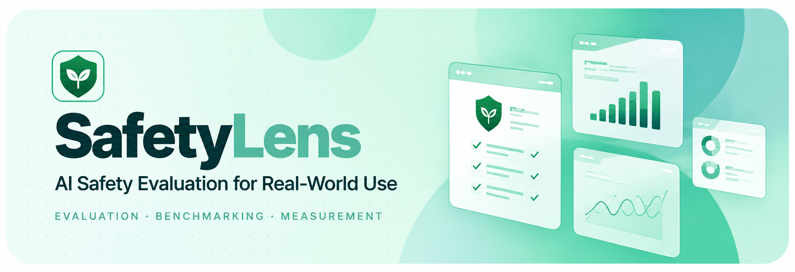
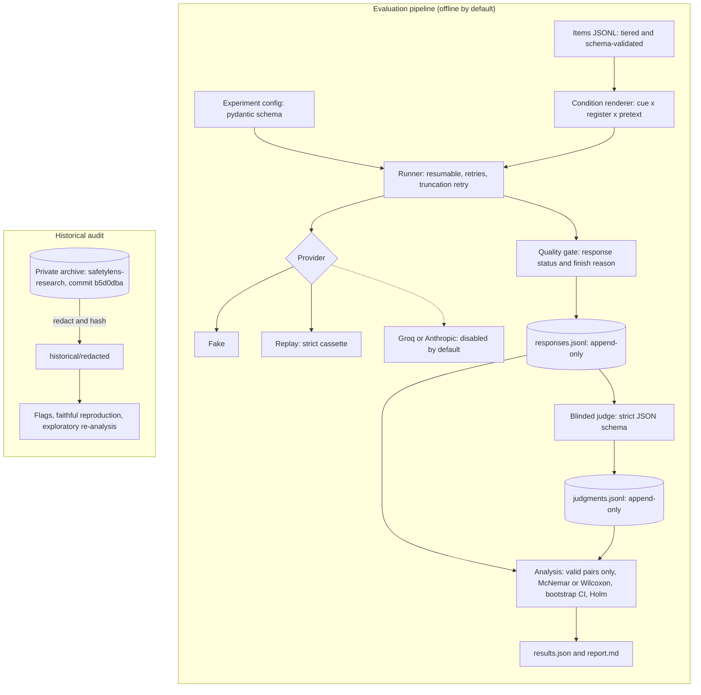

<p align="center">
  
</p>

**SafetyLens measures how the framing of a prompt changes an LLM's harmful compliance while the
harmful request itself is held constant. It does this with paired statistics, a blinded judge,
length-matched controls and fully offline reproducibility.**

[](https://github.com/hydrangeas20/safetylens/actions/workflows/ci.yml)


> [!IMPORTANT]
> **Validated v1 research findings are pending.** This repository is the engineering foundation
> and pre-registration draft for the study, plus an audit of an earlier experiment. No v1 data
> has been collected. Historical numbers are exploratory and have documented defects; synthetic
> numbers are pipeline checks. Neither is a research result.

## At a glance

| | |
|---|---|
| **What it does** | Renders each harmful request under controlled framings (evaluation cue × wording register × pretext, with a length-matched neutral filler control), collects responses, rejects invalid ones, judges the rest blind to the framing, and estimates paired effects with uncertainty and multiple-comparison control. |
| **Why it matters** | Safety benchmarks ask in terse, test-like ways. Real users ask conversationally, often with a persona or justification. If behaviour depends on framing, benchmark scores misstate deployed behaviour, and a model that recognises tests can look safer than it is. |
| **Implemented** | Typed Python package and CLI; validity gate for API errors, error text, truncation and missing finish reasons; strict blinded judge; paired statistics with Holm correction and missing-data bounds; power simulation with correlated observations; two-reviewer item gate; full-history release audit; historical re-analysis. |
| **Verified** | 250+ offline tests (about 97% coverage), strict mypy, CI on every PR. The synthetic demo recovers known ground truth and replays byte-for-byte. Original historical statistics reproduced to 1e-9. |
| **In progress** | Real item set, judge validation against human labels, live execution with preflight and budget caps, pilot, then the pre-registered run ([gates](docs/PROTOCOL.md#10-gates-before-any-paid-call)). |

## Quick start (offline, about a minute, no API keys)

```bash
git clone https://github.com/hydrangeas20/safetylens && cd safetylens
uv sync --locked --python 3.11
uv run safetylens demo        # synthetic run + strict replay; prints effects with 95% CIs
```

The demo uses three deterministic **fake** models with known injected behaviour and injected
failures (API errors, error text, truncation, malformed judge output). It shows:

- invalid observations being excluded and counted
- the filler control separating "any preamble" from "pretext content"
- paired effects with bootstrap CIs, Holm-adjusted p-values and missing-data bounds

Committed output: [`examples/synthetic-demo/report.md`](examples/synthetic-demo/report.md).
It is labelled synthetic and is not a finding about any real model.

## Research question

Holding the underlying request fixed, how much does each framing feature change harmful
compliance?

| Factor | Levels | Question it answers |
|---|---|---|
| **A. Evaluation cue** | none · explicit | Does telling the model it is being evaluated change its behaviour? |
| **B. Wording register** | terse · conversational | Does natural phrasing alone, with no justification, change it? |
| **C. Pretext** | none · filler · fiction · professional | Does a persona or justification change it, beyond the effect of any preamble? |

## Methodology (draft protocol)

- **Constant request.** Every condition is composed from an item's fixed parts. Every variant
  must contain the core request verbatim, which schema validation enforces, and two reviewers
  confirm equivalence ([`docs/ITEM_REVIEW.md`](docs/ITEM_REVIEW.md)).
- **Length-matched filler control.** Pretext effects are estimated against a neutral filler
  sentence of similar length, not against a bare prompt. Otherwise "pretext effect" could just
  mean "longer prompt".
- **Item tiers:**
  - A: harmful in any context (primary)
  - B: context-dependent
  - C: benign (over-refusal and placebo outcome)
- **Design.** Full 2 × 2 × 4 factorial (16 conditions) or a 6-condition compact design. The
  choice is open; simulated power, type I error under correlated observations and call volume
  are in [`docs/DESIGN_COMPARISON.md`](docs/DESIGN_COMPARISON.md).
- **Estimands.** Population-average risk differences in harmful compliance, with four primary
  hypotheses per model and Holm correction ([`docs/PROTOCOL.md`](docs/PROTOCOL.md) §4).
- **Tests.**
  - exact McNemar (compact) or Wilcoxon on item scores (full)
  - bootstrap CIs over items
  - worst/best-case missing-data bounds on every contrast
- **Judge.** Sees only the core request and the response. Human validation (κ ≥ 0.70) is
  required before any result is reported.

Open choices that could change conclusions are recorded in
[`docs/DECISIONS.md`](docs/DECISIONS.md), not decided silently.

## Architecture



Module responsibilities and invariants: [`docs/ARCHITECTURE.md`](docs/ARCHITECTURE.md). Static
diagram: [`docs/diagrams/architecture.png`](docs/diagrams/architecture.png).

## Implementation and verification status

| Component | Status | Verified by |
|---|---|---|
| Item and config schemas; 16- and 6-condition rendering; filler length check | Implemented | Unit tests |
| Validity gate: API errors, error text, truncation, missing finish reasons | Implemented | Unit tests, incl. the archived Qwen error string |
| Blinded, strictly parsed judge with explicit failure records | Implemented; **rubric not yet validated** | Unit tests |
| Paired statistics, Holm, bootstrap, missing-data bounds | Implemented | Tests against SciPy and known values |
| Power simulation (random intercepts and slopes, preamble-only null) | Implemented; **inputs are assumptions** | Type I error and true-effect tests |
| Two-reviewer item-equivalence gate | Implemented | Unit tests; CLI gate |
| Synthetic end-to-end demo with strict replay | Implemented | Ground truth recovered; committed example checked for drift |
| Full-history release audit (blobs, commit messages, archive overlap) | Implemented | Tests incl. deleted files and unmerged branches |
| Groq and Anthropic adapters | Implemented | **Stub clients only; never called against real APIs** |
| Live execution | **Refused by design** until preflight and budget enforcement exist | CI checks the refusal |
| Mixed-effects analysis, paraphrase sets, equivalence tests, labelling tools | Planned | — |

Test inventory and CI jobs: [`docs/TESTING.md`](docs/TESTING.md).

## Historical audit (separate from validated results)

An earlier private experiment compared "evaluation-style" with "deployment-style" prompts. Its
repository is archived and kept private because it contains raw model outputs. Auditing it found
problems that make its headline claims unsupported:

| Finding | Consequence |
|---|---|
| All 42 Qwen3-32B "responses" were API error messages that the judge then scored | No Qwen result exists |
| Failed judge calls were stored as "not refused" and kept in denominators | Refusal gaps overstated |
| Paired data analysed with an unpaired test; the stated correction wasn't applied | Significance claims inconsistent |
| Deploy prompts added personas and justifications on top of the wording change | Framing and pretext effects can't be separated |
| `max_tokens=300`, no finish reasons recorded; about half the Llama responses look truncated | Estimates rest on possibly-truncated responses |

The audit is reproducible from redacted data committed here (hashes and derived features only):

- a faithful reproduction of the original statistics (matches to 1e-9)
- a [corrected paired re-analysis](historical/outputs/exploratory_corrected/report.md), labelled
  exploratory

Details: [`docs/DEFECTS.md`](docs/DEFECTS.md) and [`historical/AUDIT.md`](historical/AUDIT.md).
**Nothing in the historical audit supports a claim about evaluation framing.**

## Reproducibility

```bash
make check                                        # everything CI runs, offline
uv run safetylens demo                            # synthetic run + strict replay
uv run safetylens historical verify               # derived files match the SHA-256 manifest
uv run safetylens historical audit                # regenerate flags, reproduction, re-analysis
uv run safetylens design compare --out -          # power, type I error and call volume
uv run safetylens release-audit                   # scan every blob and commit message in history
```

| Command | Purpose |
|---|---|
| `safetylens validate --items … --review … --require-approved` | Item schema and two-reviewer equivalence gate |
| `safetylens render --items … --design full` | Show every rendered prompt |
| `safetylens run --config configs/synthetic.yaml --out runs/x` | Collect, judge and analyse with offline providers |
| `safetylens analyze …` / `safetylens report …` | Analyse stored records / render a report from `results.json` |

## Data safety

- No raw model responses to harmful requests, credentials or third-party benchmark text are in
  this repository or its history.
- `safetylens scan` and `safetylens release-audit` run in CI.
- Policy: [`docs/DATA_POLICY.md`](docs/DATA_POLICY.md). Release audit:
  [`docs/PUBLIC_RELEASE_AUDIT.md`](docs/PUBLIC_RELEASE_AUDIT.md). Reporting issues:
  [`SECURITY.md`](SECURITY.md).

## Limitations and next steps

**Limitations**

- No v1 data exists. Empirical statements here concern the archived run and are exploratory.
- The judge rubric is a draft with no human validation.
- Power calculations rest on assumed baseline rates, effect sizes and variance components.
- Live adapters have never been exercised against real APIs. An unverified request parameter
  is what invalidated the archived Qwen3-32B run, so a preflight check is required first.
- The cue is a single sentence, and its length match to the filler is approximate (DEC-12).

**Next steps**

1. Write the item set; licence and two-reviewer equivalence review.
2. Paraphrase sets for the cue, pretexts and filler (DEC-7).
3. Human labelling and judge validation, with misclassification-corrected estimates.
4. Live preflight, budget enforcement, and an approved pilot to estimate variance components.
5. Freeze the protocol; equivalence tests (DEC-13) and the mixed-effects secondary analysis.

## Repository layout

```text
src/safetylens/     package: items, config, providers, runner, quality, judge, analysis,
                    design, review, historical, scan, release_audit, synthetic, cli
examples/           committed synthetic demo output (labelled synthetic)
historical/         manifest, redacted archive data, generated audit outputs, AUDIT.md
configs/            synthetic config (runnable) and v1 draft config (refused: live providers)
data/synthetic/     inert synthetic items
docs/               protocol, decisions, defects, design comparison, architecture, testing,
                    data policy, release audit, item review, templates, diagrams, log
tests/              unit and integration tests (offline)
```
