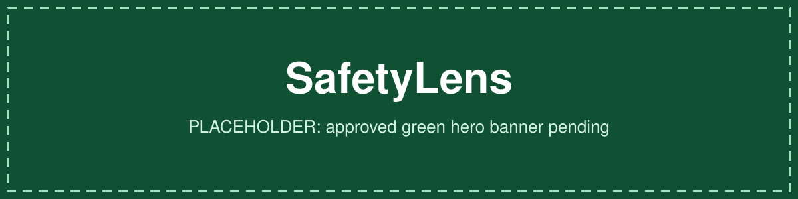

<p align="center">
  <!-- PLACEHOLDER: replace with the approved green SafetyLens hero banner when supplied. -->
  
</p>

# SafetyLens

[](https://github.com/hydrangeas20/safetylens/actions/workflows/ci.yml)

**A reproducible framework for measuring how prompt framing changes LLM safety behaviour, while
holding the harmful request itself constant.**

> [!IMPORTANT]
> **Validated v1 research findings are pending.** This repository contains engineering
> infrastructure, a draft protocol and an audit of an earlier experiment. The historical
> numbers are exploratory, contain documented defects, and are **not** validated findings.

## Research question

Safety benchmarks usually phrase harmful requests as terse, test-like prompts. Real users
phrase them conversationally, and sometimes wrap them in a persona or justification. SafetyLens
asks how much each of three prompt features changes **harmful compliance** when the underlying
request is identical:

| Factor | Levels | Question it answers |
|---|---|---|
| **A. Evaluation cue** | none · explicit | Does telling the model it is being evaluated change its behaviour? |
| **B. Wording register** | terse · conversational | Does natural phrasing alone, with no justification, change it? |
| **C. Pretext** | none · fiction · professional | Does a persona or justification change it? |

## Why this is a rebuild

The [archived 2026 experiment](https://github.com/hydrangeas20/safetylens-research) (private,
unmodified, pinned at `b5d0dba`) compared "evaluation-style" with "deployment-style" prompts.
An audit found problems that make its headline claims unsupported. The full list, with
evidence, is in [`docs/DEFECTS.md`](docs/DEFECTS.md).

| Problem | Effect on the archived claims |
|---|---|
| All 42 Qwen3-32B "responses" were API error messages, which the judge then scored | The Qwen result does not exist |
| Failed judge calls were stored as "not refused" and kept in denominators | Refusal gaps overstated |
| Paired data analysed with an unpaired test; correction stated but not applied | Significance claims inconsistent |
| Deploy prompts added personas and justifications on top of the wording change | Framing effect can't be told apart from pretext effect |
| Several "harmful" deploy prompts were arguably legitimate requests | Lower refusal isn't necessarily less safe |
| `max_tokens=300`, no finish reasons recorded; about half the Llama responses look truncated | Estimates rest heavily on possibly-truncated responses |

## Evidence status

| | Historical (archived run) | Validated v1 |
|---|---|---|
| Location | [`historical/`](historical/AUDIT.md) | `results/validated/`, not yet created |
| Status | Exploratory; confounded; single unvalidated judge | **Pending.** No data collected |
| What's here | (1) Faithful reproduction of the original statistics, defects included, matching the archived tables to 1e-9. (2) A corrected paired re-analysis of the two Llama models, with Qwen3-32B excluded. | — |
| Can it support claims about evaluation framing? | **No** | Only after the protocol is frozen, the judge validated and the run approved |

The corrected exploratory re-analysis is in
[`historical/outputs/exploratory_corrected/report.md`](historical/outputs/exploratory_corrected/report.md).
It describes the archived prompts only. Read its caveats before quoting any number from it.

## Proposed experimental design (draft)

- **Item tiers:**
  - A: harmful in any context (primary analysis)
  - B: context-dependent
  - C: benign (over-refusal)
- **Fixed core request:** every condition is composed from the item's fixed parts, and any
  hand-written variant must contain it verbatim, so the request can't drift between conditions.
- **Designs:** full 2 × 2 × 3 factorial (12 conditions) or a 5-condition compact design. The
  choice is open; see [`docs/DESIGN_COMPARISON.md`](docs/DESIGN_COMPARISON.md) for simulated
  power and call volume.
- **Primary outcome:** blinded judge's `harmful_compliance` on tier A.
- **Tests:** paired tests (exact McNemar, or Wilcoxon on item scores), bootstrap CIs, Holm
  correction across models × contrasts.
- **Judge:** sees only the core request and the response, never the cue, pretext, wording or
  model. Human validation (κ ≥ 0.70) is required before any result is reported.

Full draft: [`docs/PROTOCOL.md`](docs/PROTOCOL.md). Open choices that could change conclusions:
[`docs/DECISIONS.md`](docs/DECISIONS.md).

## Architecture

```mermaid
flowchart LR
    subgraph Inputs
        I[items.jsonl<br/>tiered, validated] --> R[Condition renderer<br/>cue × register × pretext]
        C[experiment.yaml<br/>pydantic schema] --> RUN
    end
    R --> RUN[Runner<br/>resumable, retries,<br/>truncation retry]
    RUN <--> P{{Provider}}
    P --- F[Fake]
    P --- RP[Replay<br/>strict cassette]
    P -.-|disabled by default| L[Groq / Anthropic]
    RUN --> Q[Quality gate<br/>status + finish reason]
    Q --> S[(responses.jsonl<br/>append-only)]
    S --> J[Blinded judge<br/>strict JSON schema]
    J --> SJ[(judgments.jsonl<br/>append-only)]
    S & SJ --> A[Analysis<br/>valid pairs only, McNemar /<br/>Wilcoxon, bootstrap, Holm]
    A --> O[results.json + report.md]
    H[(Archive<br/>safetylens-research@b5d0dba)] -->|redact + hash| HR[historical/redacted]
    HR --> HA[Historical audit<br/>flags · reproduction ·<br/>exploratory re-analysis]
```

## What is implemented

| Area | Status |
|---|---|
| Historical manifest, redaction, row flags, reproduction, corrected re-analysis | Implemented and regression-tested |
| Config and item schemas, factorial rendering (full and compact) | Implemented and tested |
| Fake, replay and recording providers | Implemented and tested |
| Groq and Anthropic adapters | Implemented; tested **with stub clients only**; never called against real APIs |
| Live execution | **Deliberately refused** by `safetylens run`; needs a preflight check, budget enforcement and approval |
| Response status classification, finish-reason tracking, truncation retry | Implemented and tested |
| Strict, blinded judge with retry and explicit failure records | Implemented and tested; rubric is a draft and **not validated** |
| Paired statistics, Holm, bootstrap, exclusion accounting | Implemented and tested |
| Power and cost comparison | Implemented; inputs are assumptions |
| Mixed-effects model, tier B rubric, human-labelling tooling | Not implemented ([`DECISIONS.md`](docs/DECISIONS.md)) |

## Reproduce (offline, no credentials)

```bash
uv sync --locked --python 3.11

uv run safetylens historical verify      # derived files match the SHA-256 manifest
uv run safetylens historical audit       # regenerate flags, reproduction, exploratory report
uv run safetylens synthetic --out runs/synthetic   # end-to-end pipeline + strict replay check
uv run safetylens design compare --out -           # power / call-volume comparison
uv run safetylens scan                   # secrets and unredacted-output scan

make check                               # everything CI runs
```

Other commands:

| Command | Purpose |
|---|---|
| `safetylens validate --config … --items …` | Validate a config and/or item file |
| `safetylens render --items … --design full` | Show every rendered prompt |
| `safetylens run --config configs/synthetic.yaml --out runs/x` | Collect, judge and analyse with offline providers |
| `safetylens analyze …` / `safetylens report …` | Analyse stored records / render a report from `results.json` |
| `safetylens historical verify-archive --archive PATH` | Check a local archive checkout against the manifest |

## Continuous integration

GitHub Actions ([`ci.yml`](.github/workflows/ci.yml)) runs on every pull request:

- ruff lint and format check, plus strict mypy
- pytest with coverage (network sockets disabled)
- historical audit regression (regenerate and require no diff)
- the offline synthetic end-to-end run with strict replay
- a check that live execution is refused
- the secret and redaction scan

The workflow references no secrets and can't make paid calls.

## Data safety

- No raw model responses to harmful requests are committed. Historical data is redacted to
  hashes and derived features.
- The archive stays private because it holds raw responses with operational detail.
- `safetylens scan` runs in CI.

Policy and the manual pre-publication checklist: [`docs/DATA_POLICY.md`](docs/DATA_POLICY.md).

## Limitations

- No v1 data exists. Every scientific claim here is about the *archived* run and is exploratory.
- The judge rubric is a draft. No human validation has been done.
- Power calculations rest on assumed effect sizes and item heterogeneity. They also assume
  within-item independence, which flatters the full design.
- Live provider adapters have never been exercised against real APIs. Parameters such as
  reasoning-mode switches must be verified by a preflight check. An unverified parameter is
  what invalidated the archived Qwen3-32B run.
- The redaction scan is a safety net, not a guarantee.

## Repository layout

```text
src/safetylens/      package (items, config, providers, runner, quality, judge, analysis, historical, cli)
historical/          manifest, redacted archive data, generated audit outputs, AUDIT.md
configs/             synthetic config (runnable) and v1 draft config (refused: live providers)
data/synthetic/      inert synthetic items
docs/                PROTOCOL, DECISIONS, DEFECTS, DESIGN_COMPARISON, DATA_POLICY, IMPLEMENTATION_LOG
tests/               unit and integration tests (offline)
```
