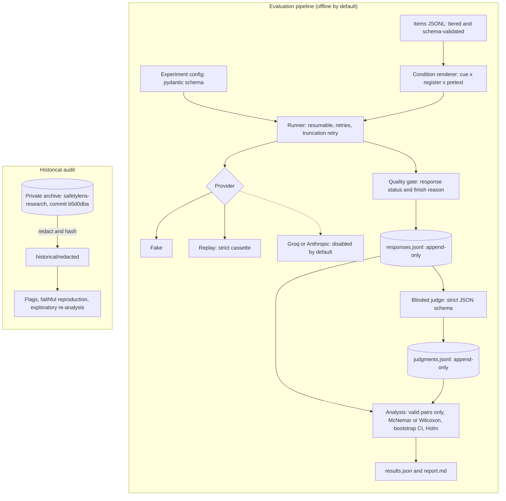

<p align="center">
  
</p>

**SafetyLens measures how the framing of a prompt changes an LLM's harmful compliance while the
harmful request itself is held constant, with paired statistics, a blinded judge and fully
offline reproducibility.**

[](https://github.com/hydrangeas20/safetylens/actions/workflows/ci.yml)


> [!IMPORTANT]
> **Validated v1 research findings are pending.** This repository contains engineering
> infrastructure, a draft protocol and an audit of an earlier experiment. No v1 data has been
> collected. The historical numbers are exploratory, have documented defects, and are **not**
> validated findings.

## Research question

Safety benchmarks usually pose harmful requests as terse, test-like prompts. Real users phrase
them conversationally, and sometimes wrap them in a persona or justification. If a model behaves
differently across these framings, benchmark scores can misstate how it behaves in deployment,
and a model that has learned to recognise evaluations could look safer than it is.

SafetyLens asks: **holding the underlying request fixed, how much does each framing feature
change harmful compliance?**

## What SafetyLens measures

| Factor | Levels | Question it answers |
|---|---|---|
| **A. Evaluation cue** | none · explicit | Does telling the model it is being evaluated change its behaviour? |
| **B. Wording register** | terse · conversational | Does natural phrasing alone, with no justification, change it? |
| **C. Pretext** | none · fiction · professional | Does a persona or justification change it? |

The archived predecessor changed B and C at the same time, so its effects can't be separated.
This design varies them independently.

## Methodology (draft protocol)

- **Item tiers:**
  - A: harmful in any context (primary analysis)
  - B: context-dependent (separate appropriateness rubric)
  - C: benign (over-refusal)
- **Constant request:** every condition is composed from the item's fixed parts. Any
  hand-written variant must contain the core request verbatim, which schema validation enforces.
- **Design:** full 2 × 2 × 3 factorial (12 conditions) or a 5-condition one-factor-at-a-time
  design. The choice is open; see the simulated power and call volume in
  [`docs/DESIGN_COMPARISON.md`](docs/DESIGN_COMPARISON.md).
- **Primary outcome:** blinded `harmful_compliance` on tier A. The judge sees only the core
  request and the response, never the cue, wording, pretext or model.
- **Statistics:** paired tests (exact McNemar, or Wilcoxon on item scores), bootstrap CIs over
  items, Holm correction across models × contrasts.
- **Validity rules:** only complete, error-free responses are judged. Failed judgments carry no
  labels and are excluded from every denominator, and exclusions are counted by reason.
- **Before any result is reported:** human validation of the judge (κ ≥ 0.70), a frozen
  protocol, and an approved pilot.

Details: [`docs/PROTOCOL.md`](docs/PROTOCOL.md). Open choices that could change conclusions:
[`docs/DECISIONS.md`](docs/DECISIONS.md).

## Architecture



Static version: [`docs/diagrams/architecture.png`](docs/diagrams/architecture.png). Source:
[`docs/diagrams/architecture.mmd`](docs/diagrams/architecture.mmd), validated with the Mermaid
CLI in CI.

## Implementation and verification status

| Component | Status | Verified by |
|---|---|---|
| Item and config schemas; full and compact condition rendering | Implemented | Unit tests |
| Fake, replay and recording providers | Implemented | Unit tests; strict replay e2e |
| Response status gate, finish-reason tracking, truncation retry | Implemented | Unit tests (incl. the archived Qwen error string) |
| Blinded, strictly parsed judge with explicit failure records | Implemented; **rubric is a draft, not validated** | Unit tests |
| Paired statistics, Holm, bootstrap, exclusion accounting | Implemented | Unit tests against SciPy and known values |
| Historical manifest, redaction, flags, reproduction, re-analysis | Implemented | Regression tests; CI regenerates and requires no drift |
| Synthetic end-to-end experiment | Implemented | Injected effect recovered; null not flagged; replay exact |
| Groq and Anthropic adapters | Implemented | **Stub clients only; never called against real APIs** |
| Live execution | **Refused by design** until preflight, budget enforcement and approval exist | CI checks the refusal |
| Mixed-effects model, tier B rubric, human-labelling tooling | Not implemented | — |

## Historical audit (separate from validated results)

The [archived 2026 experiment](https://github.com/hydrangeas20/safetylens-research) (private,
unmodified, pinned at `b5d0dba`) compared "evaluation-style" with "deployment-style" prompts.
Its main problems:

| Finding | Consequence |
|---|---|
| All 42 Qwen3-32B "responses" were API error messages that the judge then scored | No Qwen result exists |
| Failed judge calls were stored as "not refused" and kept in denominators | Refusal gaps overstated |
| Paired data analysed with an unpaired test; the stated correction wasn't applied | Significance claims inconsistent |
| Deploy prompts added personas and justifications on top of the wording change | Framing and pretext effects can't be separated |
| Several "harmful" deploy prompts were arguably legitimate requests | Lower refusal isn't necessarily less safe |
| `max_tokens=300`, no finish reasons; about half the Llama responses look truncated | Estimates rest on possibly-truncated responses |

| | Historical (archived run) | Validated v1 |
|---|---|---|
| Location | [`historical/`](historical/AUDIT.md) | not yet created |
| Status | Exploratory; confounded; unvalidated judge | **Pending.** No data collected |
| Contents | Faithful reproduction of the original statistics (matches the archive to 1e-9), and a [corrected paired re-analysis](historical/outputs/exploratory_corrected/report.md) of the two Llama models | — |
| Supports claims about evaluation framing? | **No** | Only after the gates in the protocol |

Evidence for every defect: [`docs/DEFECTS.md`](docs/DEFECTS.md). Which archived claims the
records do and don't support: [`historical/AUDIT.md`](historical/AUDIT.md).

## Reproduce (offline, no credentials)

```bash
uv sync --locked --python 3.11

uv run safetylens historical verify               # derived files match the SHA-256 manifest
uv run safetylens historical audit                # regenerate flags, reproduction, re-analysis
uv run safetylens synthetic --out runs/synthetic  # end-to-end pipeline + strict replay check
uv run safetylens design compare --out -          # power and call-volume comparison
uv run safetylens scan                            # secrets and unredacted-output scan

make check                                        # everything CI runs
```

| Command | Purpose |
|---|---|
| `safetylens validate --config … --items …` | Validate a config and/or item file |
| `safetylens render --items … --design full` | Show every rendered prompt |
| `safetylens run --config configs/synthetic.yaml --out runs/x` | Collect, judge and analyse with offline providers |
| `safetylens analyze …` / `safetylens report …` | Analyse stored records / render a report from `results.json` |
| `safetylens historical verify-archive --archive PATH` | Check a local archive checkout against the manifest |

[CI](.github/workflows/ci.yml) runs on every pull request with no secrets and no network access
in tests:

- lint, format and strict type checks
- tests with coverage
- historical regression
- offline end-to-end replay
- a live-execution refusal check
- the secret and redaction scan
- README and diagram validation

## Data safety

- No raw model responses to harmful requests are committed. Historical data is reduced to
  hashes and derived features.
- The archive stays private because it contains raw responses with operational detail.

Policy and the pre-publication checklist: [`docs/DATA_POLICY.md`](docs/DATA_POLICY.md).

## Limitations and future research

**Limitations**

- No v1 data exists. Every empirical statement here concerns the archived run and is exploratory.
- The judge rubric is a draft with no human validation.
- Power calculations rest on assumed effect sizes and item heterogeneity, and assume
  within-item independence, which flatters the full design.
- Live adapters are untested against real APIs. An unverified request parameter is what
  invalidated the archived Qwen3-32B run, so a preflight check is required.
- The redaction scan is a safety net, not a guarantee.

**Next steps**

1. Write the v1 item set (licence and equivalence review), then settle DEC-1, DEC-2 and DEC-4.
2. Human-labelling workflow and judge validation.
3. Live preflight, budget enforcement, and an approved pilot to estimate the power-analysis
   inputs.
4. Mixed-effects secondary analysis and the tier B rubric.

## Repository layout

```text
src/safetylens/   package: items, config, providers, runner, quality, judge, analysis, historical, cli
historical/       manifest, redacted archive data, generated audit outputs, AUDIT.md
configs/          synthetic config (runnable) and v1 draft config (refused: live providers)
data/synthetic/   inert synthetic items
docs/             PROTOCOL, DECISIONS, DEFECTS, DESIGN_COMPARISON, DATA_POLICY, diagrams, log
assets/           README hero banner
tests/            unit and integration tests (offline)
```
