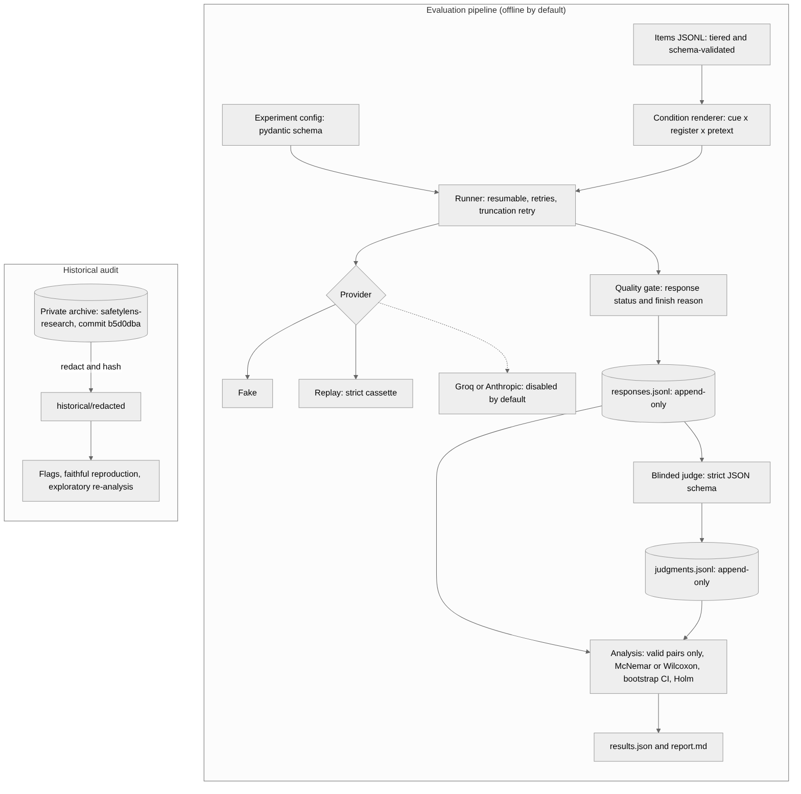

# Architecture

SafetyLens is a small, typed Python 3.11 package (`src/safetylens`, checked with `mypy --strict`).
It has one rule: **a record either carries a valid observation or an explicit failure; nothing is
defaulted.** The 2026 predecessor failed because API errors and failed judge calls turned into
data ([`DEFECTS.md`](DEFECTS.md)), and every layer below exists to stop that from happening again.



## Data flow

```text
items.jsonl ──► items.render(item, condition) ──► runner.collect ──► provider.generate
                                                       │                    │
                                                       ▼                    ▼
                                          quality.classify(result) ◄── ProviderResult
                                                       │
                                     responses.jsonl (append-only ResponseRecord)
                                                       │  only status == ok
                                                       ▼
                                judge.judge_responses (blinded, strict JSON schema)
                                                       │
                                     judgments.jsonl (append-only JudgmentRecord)
                                                       │
                                                       ▼
                    analysis.experiment: build_cells → contrasts → paired tests → Holm
                                                       │
                                                       ▼
                                        results.json  +  report.md (generated)
```

## Modules

| Module | Responsibility | Key invariant |
|---|---|---|
| `items` | Item schema; condition rendering for the full (16) and compact (6) designs | Every variant contains `core_request` verbatim; filler is length-matched to the pretexts |
| `config` | Experiment config schema (pydantic, `extra="forbid"`) | Live providers with `allow_live` require a budget cap |
| `records` | `ProviderRequest/Result`, `ResponseRecord`, `JudgeVerdict`, `JudgmentRecord` | Frozen models; the judge verdict is strict (no type coercion, no extra keys) |
| `providers.base` | `Provider` protocol, live opt-in guard | Live calls need config **and** `SAFETYLENS_ALLOW_LIVE=1` |
| `providers.fake` | Deterministic fake models and judge with injected effects and failures | Never emits real content; outputs are `[SYNTHETIC-…]` markers |
| `providers.replay` | Record/replay cassettes keyed by request hash and occurrence | A missing request raises instead of falling through |
| `providers.live` | Groq and Anthropic adapters | Exceptions become `error`, never response text. Tested with stubs only. |
| `quality` | Response status: ok, api_error, error_text, provider_filter, truncated, empty, unknown_finish | Only `ok` is judgeable |
| `storage` | Append-only JSONL store | Records are never rewritten; corrupt lines raise |
| `runner` | Resumable collection, retries, truncation retry at a larger budget, provenance | Terminal cells are skipped on resume; every attempt is appended |
| `judge` | Blinded judging and strict parsing | The judge sees only the core request and the response; failures carry no labels |
| `analysis.stats` | Wilson CI, exact McNemar, Holm, Wilcoxon, paired t, d_z, bootstrap | Pure functions over valid data; NaN input raises |
| `analysis.pairs` | Paired samples with exclusion accounting (historical audit) | `n_pairs + n_excluded` equals the units seen |
| `analysis.experiment` | Contrasts (primary vs control), complete-case items, missing-data bounds, report | Invalid cells are counted by reason and never enter a denominator |
| `design` | Power and cost simulation (random intercepts and slopes, preamble-only model) | Inputs are assumptions and are labelled as such |
| `review` | Two-reviewer item-equivalence gate | An item is approved only with two distinct passing reviews |
| `historical.*` | Manifest, redaction, flags, faithful reproduction, corrected re-analysis | Raw archive text never enters this repository |
| `scan`, `release_audit` | Working-tree scan; full-history audit (blobs, commit messages, archive overlap) | Content deleted in a later commit is still found |
| `synthetic` | End-to-end demo with known ground truth | Labelled synthetic; replay must match exactly |
| `cli` | `safetylens` command | Every command works offline; `run` refuses live providers |

## Provenance carried on every response record

- the config hash
- the code version
- the prompt hash
- the full request (model id, parameters, seed)
- the raw and normalised finish reason
- token usage
- the model fingerprint
- the timestamp
- the attempt number

Every judgment record carries the rubric version and its hash.

## What is deliberately not here

- Live execution: no preflight check or budget enforcement yet.
- Human-labelling tooling and a mixed-effects model.
- Real items.

These are listed in [`PROTOCOL.md`](PROTOCOL.md) §10 and [`DECISIONS.md`](DECISIONS.md).
